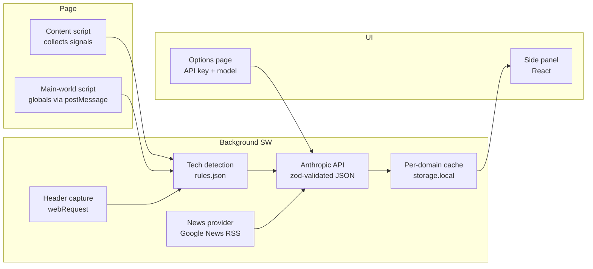

# Prospect Brief

**Prospect Brief** is a Chrome extension (Manifest V3) for sales engineers and forward deployed engineers. When you're on any company's website, click the toolbar icon and it generates a one-page account brief: a company overview, the detected tech stack, recent news headlines, and suggested discovery talking points — the kind of prep you'd do before a customer call, in seconds instead of an hour.

## Features

- **Company overview** — 3–5 sentence brief: what they sell, who they buy from, business model (LLM-written, grounded in page content).
- **Tech stack detection** — deterministic rules scan scripts, globals, meta tags, headers, and cookies; grouped by category with confidence and evidence.
- **Recent news** — 3–5 headlines with dates and links via Google News RSS (swappable provider interface).
- **Talking points** — 3–5 discovery questions/angles, each citing the finding it came from.
- **Caching** — briefs cached per domain; Regenerate, Copy as Markdown, and print-friendly export.

## Load unpacked in Chrome

1. `npm install`
2. `npm run build`
3. Open `chrome://extensions`, enable **Developer mode**.
4. **Load unpacked** → select the `.output/chrome-mv3` directory.
5. Pin the extension, visit any company site, click the icon.

## API key setup

1. Right-click the extension icon → **Options** (step 5 adds this page).
2. Paste your Anthropic API key. It's stored in `chrome.storage.local` on your machine only — never committed, never sent anywhere except `api.anthropic.com`.
3. Pick a model (default: `claude-sonnet-4-20250514` — check step 5 for the current default).

## Permissions

| Permission                    | Why                                                                        |
| ----------------------------- | -------------------------------------------------------------------------- |
| `activeTab`                   | Read the current tab's URL/title when you click the icon.                  |
| `scripting`                   | Run the signal-collection scripts on the page you asked about.             |
| `sidePanel`                   | Render the brief UI in Chrome's side panel.                                |
| `storage`                     | Store your API key, model choice, and cached briefs locally.               |
| `webRequest`                  | Read response headers (server, CDN, framework hints) of the main document. |
| `https://api.anthropic.com/*` | Send page signals + news to the LLM you configured.                        |
| `https://news.google.com/*`   | Fetch recent headlines for the company.                                    |

## Privacy

All page analysis runs locally in the extension. The only network calls are to Anthropic (your brief request) and Google News (headline search). No analytics, no tracking, no backend server, no data leaves your machine otherwise.

## Architecture

## Roadmap

- [x] Step 1: scaffold, CI, README
- [x] Step 2: side panel + raw page signals
- [x] Step 3: tech detection engine + tests
- [ ] Step 4: news fetch + parse
- [ ] Step 5: options page + LLM brief generation
- [ ] Step 6: caching, regenerate, copy/export
- [ ] Step 7: polish, error states, icon, store listing
